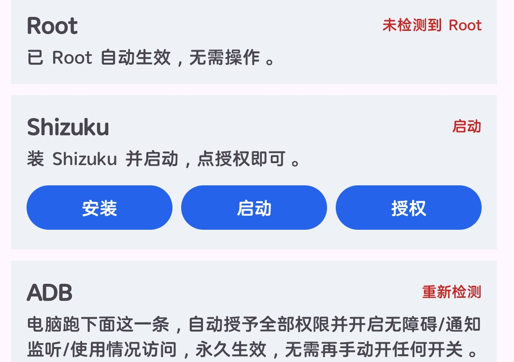
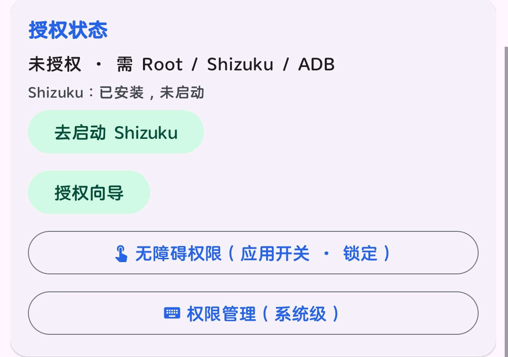
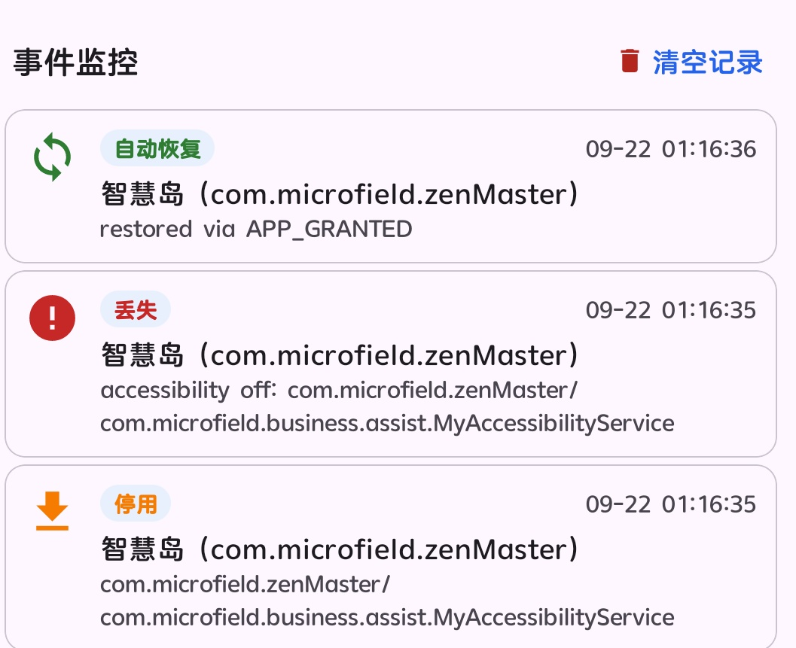

# 无障碍管理器 Pro (Accessibility Manager Pro)


支持服务保活、通知调控、开发者选项映射、权限管理等功能。


## 使用教程


### 1. 首次授权


<p style="font-size:18px;">推荐使用 <strong>ADB</strong> 激活。如果你有 Root 或者装了 Shizuku 也可以直接用，没装的话走 ADB。授权成功后软件会自动回首页。</p>


<p align="center">
  
</p>


<p style="font-size:18px;">用数据线连到电脑，开启 USB 调试后，<strong>在终端里逐行执行</strong>：</p>


```bash
pm grant com.acsmanager.pro android.permission.WRITE_SECURE_SETTINGS
settings put global enable_freeform_support 1
pm grant com.acsmanager.pro android.permission.SET_VOLUME_KEY_LONG_PRESS_LISTENER
```


### 2. 自监控


<p style="font-size:18px;">在首页找到"无障碍自监控（低耗电）"这一项，<strong>把开关打开</strong>。监听系统设置变化判断服务，不做轮询，基本不耗电。延迟时间按需调，默认 1 秒。</p>


<p align="center">
  
</p>


### 3. 配置要保护的无障碍服务


<p style="font-size:18px;">往下滑找到"授权状态"卡片，点<strong>"无障碍权限（应用开关·锁定）"</strong>进入列表。</p>


<p align="center">
  
</p>


<p style="font-size:18px;">在列表里找到想保护的无障碍服务，打开授权，<strong>右边的锁点亮</strong>。</p>


### 4. 验证


<p style="font-size:18px;">去系统的无障碍设置页，<strong>把刚才锁好的服务关掉</strong>。正常情况下，会被自动拉回。</p>


<p align="center">
  
</p>
