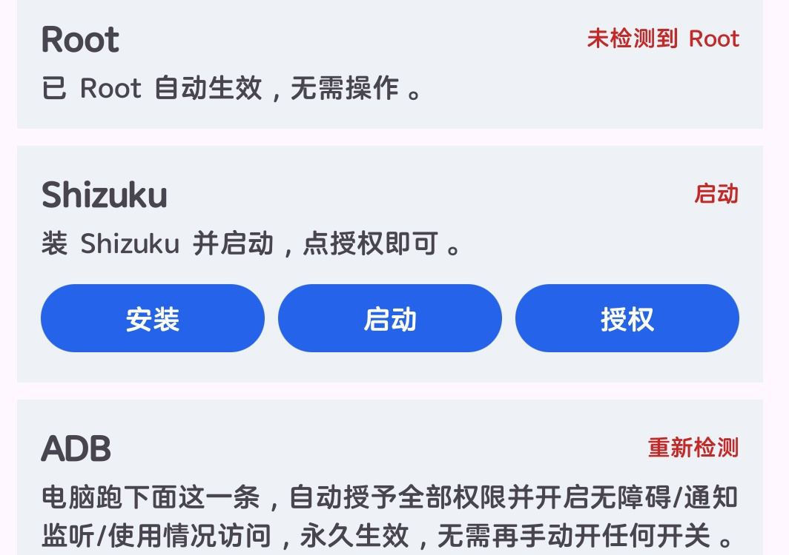
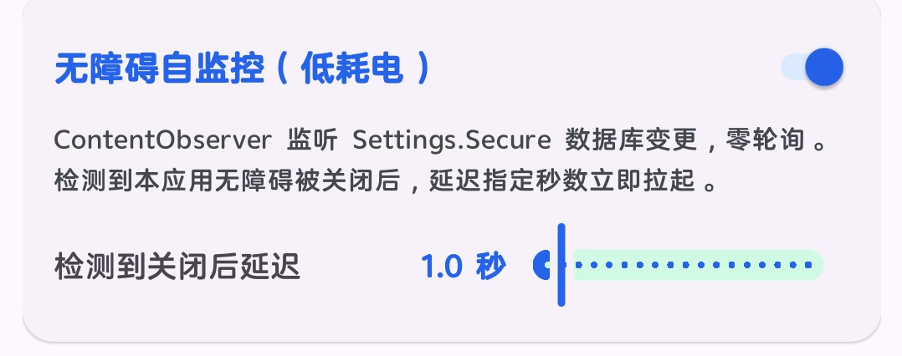
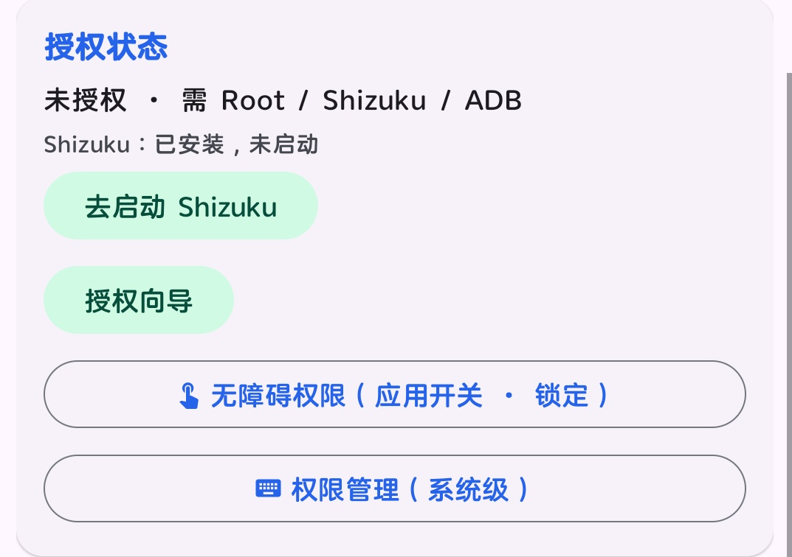
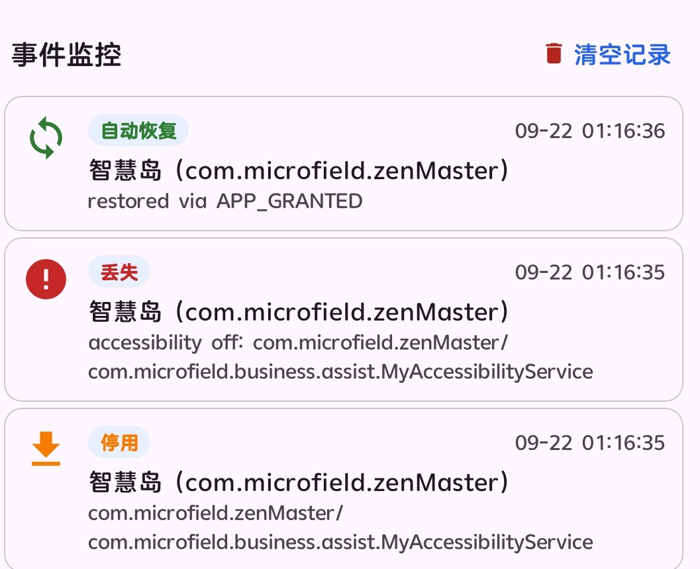

# 无障碍管理器 Pro (Accessibility Manager Pro)


基于 Android 无障碍服务的管理器，支持服务保活、通知调控、开发者选项映射、权限管理等功能。


## 更新记录

### v7.0.0 —— 保活无感化

按照「勾选保活 → 应用失去后台后自动拉回其服务 → 拉起后回到正在操作的应用 → 全程尽量无感」的理念重构保活链路：

#### **新增后台周期巡检（15 秒）：**
- 旧版只有应用「进过前台后被杀」才会被检测到；应用在后台直接死亡（从未到过前台）完全无感知。
- 新版在无障碍服务连接后启动周期巡检：对每个保活目标用特权通道（root/Shizuku）执行 `pidof` 判定进程存活，发现死亡立即处理。
- 无权限通道或未勾选任何保活目标时巡检自动空转，不产生额外开销。

#### **服务级无感拉起（有权限通道时）：**
- 勾选了「组件（服务）」级保活的目标，巡检发现死亡后优先通过特权通道执行 `am start-service` 直接恢复服务。
- 服务恢复**不启动任何界面**，屏幕上什么都不发生，完全无感；恢复成功会正常计数并更新「已拉起 N 次」通知。
- 服务恢复失败或仅为整应用保活时，才回退到原有的界面拉起 + 自动回退链路。

#### **拉起后自动回到正在操作的应用（延续 6.0.5 修复并保持）：**
- 界面拉起成功并验证到前台后，按 `keepalive_return_delay`（默认 100ms）把上一个应用带回前台。
- 验证失败（含灭屏导致事件冻结的场景）同样会把上一个应用带回前台，不再出现「拉起后停在别的应用」。


### v6.0.0


#### **闪退修复：**
- **授权通道异步执行**
- **事件日志改为单线程异步合并**


#### **运行逻辑与内存优化：**
- **通知等级/隐藏渠道读取加进程内缓存**
- **自监控自动开启、看门狗等后台线程全部改为守护线程，不阻碍进程退出。**


- **新增本地崩溃日志（crash_log.txt）：未捕获异常自动落盘（含线程、堆栈、设备、版本）。**


## 使用教程


### 1. 首次授权


<p style="font-size:18px;">推荐使用 <strong>ADB</strong> 激活。如果你有 Root 或者装了 Shizuku 也可以直接用，没装的话走 ADB。授权成功后软件会自动回首页。</p>


<p align="center">
  
</p>


<p style="font-size:18px;">用数据线连到电脑，开启 USB 调试后，<strong>在终端里跑下面这一条</strong>：</p>


```bash
pm grant com.acsmanager.pro android.permission.WRITE_SECURE_SETTINGS && pm grant com.acsmanager.pro android.permission.WRITE_SETTINGS && pm grant com.acsmanager.pro android.permission.POST_NOTIFICATIONS && appops set com.acsmanager.pro android:get_usage_stats allow && settings put secure enabled_accessibility_services com.acsmanager.pro/com.acsmanager.pro.selfguard.SelfAccessService && settings put secure accessibility_enabled 1 && settings put secure enabled_notification_listeners com.acsmanager.pro/com.acsmanager.pro.notif.NotifGateService && settings put secure notification_access_enabled 1
```


### 2. 自监控


<p style="font-size:18px;">在首页找到"无障碍自监控（低耗电）"这一项，<strong>把开关打开</strong>。监听系统设置变化判断服务，不做轮询，基本不耗电。延迟时间按需调，默认 1 秒。</p>


<p align="center">
  
</p>


### 3. 配置要保护的无障碍服务


<p style="font-size:18px;">往下滑找到"授权状态"卡片，点<strong>"无障碍权限（应用开关·锁定）"</strong>进入列表。</p>


<p align="center">
  
</p>


<p style="font-size:18px;">在列表里找到想保护的无障碍服务，打开授权，<strong>右边的锁点亮</strong>。</p>


### 4. 验证


<p style="font-size:18px;">去系统的无障碍设置页，<strong>把刚才锁好的服务关掉</strong>。正常情况下，会被自动拉回。</p>


<p align="center">
  ### v7.0.0 —— 保活无感化

按照「勾选保活 → 应用失去后台后自动拉回其服务 → 拉起后回到正在操作的应用 → 全程尽量无感」的理念重构保活链路：

#### **新增后台周期巡检（15 秒）：**
- 旧版只有应用「进过前台后被杀」才会被检测到；应用在后台直接死亡（从未到过前台）完全无感知。
- 新版在无障碍服务连接后启动周期巡检：对每个保活目标用特权通道（root/Shizuku）执行 `pidof` 判定进程存活，发现死亡立即处理。
- 无权限通道或未勾选任何保活目标时巡检自动空转，不产生额外开销。

#### **服务级无感拉起（有权限通道时）：**
- 勾选了「组件（服务）」级保活的目标，巡检发现死亡后优先通过特权通道执行 `am start-service` 直接恢复服务。
- 服务恢复**不启动任何界面**，屏幕上什么都不发生，完全无感；恢复成功会正常计数并更新「已拉起 N 次」通知。
- 服务恢复失败或仅为整应用保活时，才回退到原有的界面拉起 + 自动回退链路。

#### **拉起后自动回到正在操作的应用（延续 6.0.5 修复并保持）：**
- 界面拉起成功并验证到前台后，按 `keepalive_return_delay`（默认 100ms）把上一个应用带回前台。
- 验证失败（含灭屏导致事件冻结的场景）同样会把上一个应用带回前台，不再出现「拉起后停在别的应用」。
